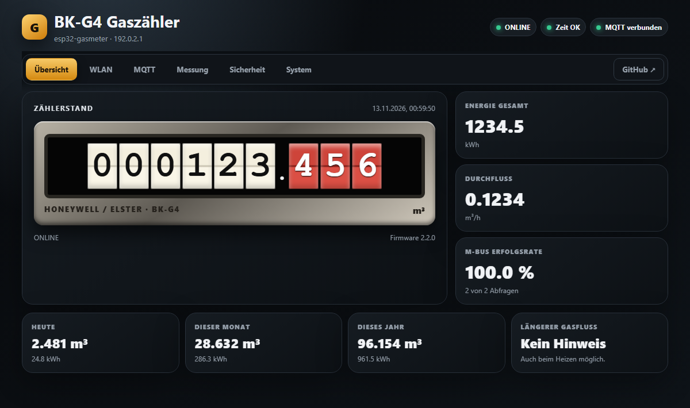

# ESP32 BK-G4AT Gas Meter Reader

ESP32 firmware for the Honeywell/Elster **BK-G4AT** (**BK-G4 AT**) with an **Absolute ENCODER**. It reads the meter register over wired M-Bus and publishes volume, energy and flow to MQTT and Home Assistant. The ESP32 also serves a local dashboard.



*WebUI overview with example readings.*

## Compatibility and wiring

Look for **BK-G4AT** and **ENCODER** on the meter. The encoder reads the digit rollers optically and reports the complete register digitally. Reed-switch pulse counting requires a pulse magnet in a compatible index. This project uses the BK-G4AT encoder's M-Bus interface. [Honeywell Absolute ENCODER](https://process.honeywell.com/us/en/products/utilities/gas/gas-metering/smart-gas-meters/absolute-encoder-ae5) · [BK-G4/BK-G4T datasheet](https://docuthek.kromschroeder.com/download.php?doc=59327&lang=de)

Use an adapter appropriate to the fitted interface. For the standard ESP32 build, connect GPIO17 (TX) to adapter RX and GPIO16 (RX) to adapter TX on the adapter's **3.3 V UART side**. The firmware uses **2400 baud, 8E1**. Follow the [hardware guide](docs/HARDWARE.md) for adapter selection, safe wiring and telegram verification.

## First installation over USB

Download the **`*-factory.bin`** and `SHA256SUMS` from [GitHub Releases](https://github.com/fgrfn/ESP32-BK-G4-Gasmeter/releases). The published images target the classic ESP32 (`esp32dev`, 4 MB flash). Flash the factory image at address `0x0`. See the [esptool example](RELEASE.md#using-the-release-files) or build from source with `pio run -e esp32dev -t upload`.

1. Open the serial monitor at **115200 baud** and start the ESP32.
2. Join `ESP32-Gas-XXXXXX` using the setup password printed in the serial log.
3. Open `http://192.168.4.1`, enter Wi-Fi and MQTT settings, then restart the ESP32.

For a fresh installation, configure the optional WebUI login and ArduinoOTA password under **Sicherheit**. The WebUI login starts disabled. If enabled, replace the initial `admin` / `admin` credentials. See [Security](SECURITY.md) for network access and password settings.

## Update over Wi-Fi

The WebUI **System** tab shows the installed version and links to GitHub. Use ArduinoOTA to send the **`*-ota.bin`** from your computer over the local network.

On Windows with the ESP32 Arduino framework installed through PlatformIO, download the OTA image and run this in PowerShell from the download directory. Replace the example IP and filename as needed. [Example release v2.2.0](https://github.com/fgrfn/ESP32-BK-G4-Gasmeter/releases/tag/v2.2.0)

```powershell
python "$env:USERPROFILE/.platformio/packages/framework-arduinoespressif32/tools/espota.py" -i 192.168.1.100 -f ./ESP32-BK-G4-Gasmeter-2.2.0-ota.bin -r
```

If you set an ArduinoOTA password, add `--auth "$env:GASMETER_OTA_PASSWORD"` after setting that variable in your shell. The [Espressif OTA uploader](https://github.com/espressif/arduino-esp32/blob/2.0.17/tools/espota.py) is also available separately.

To build and upload from source, set `GASMETER_OTA_PASSWORD` to your OTA password or an empty string, then run `pio run -e esp32dev-ota -t upload --upload-port 192.168.1.100`. After the ESP32 restarts, check the running version in **System**.

## Home Assistant and diagnostics

MQTT discovery creates the Home Assistant device and its sensors. The default topic prefix is `gasmeter/<device_id>`, with `state`, `diagnostics` and `availability` beneath it. The dashboard shows daily, monthly and yearly consumption, with 31 completed days available as CSV. See the [Home Assistant guide](docs/HOME_ASSISTANT.md) for discovery, optional controls and gas costs.

The **System** tab provides logs, M-Bus telegrams, manual polling and config backup. The firmware exposes live readings at `/api/status` and Prometheus metrics at `/metrics`.

## Development

```bash
pio test -e native
pio run -e esp32dev
python tools/replay_mbus.py test/fixtures/bk_g4_synthetic.hex --expect 123.456
```

See [Architecture](ARCHITECTURE.md), the [release workflow guide](RELEASE.md) and [GPL-3.0 license](LICENSE).

Based on [BK-G4AT2MQTT](https://github.com/BennoB666/BK-G4AT2MQTT) by BennoB666. This is a personal learning project built with help from OpenAI Codex and Claude Code.
